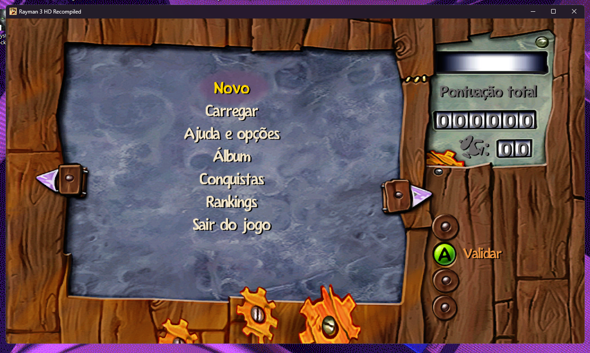
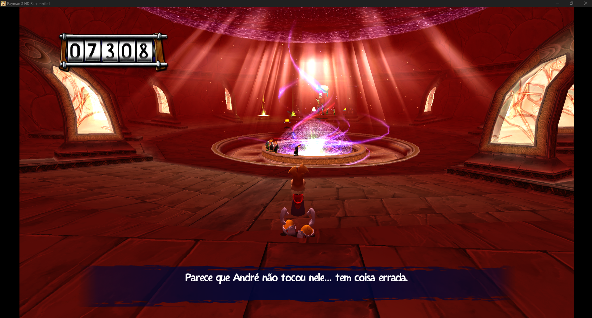
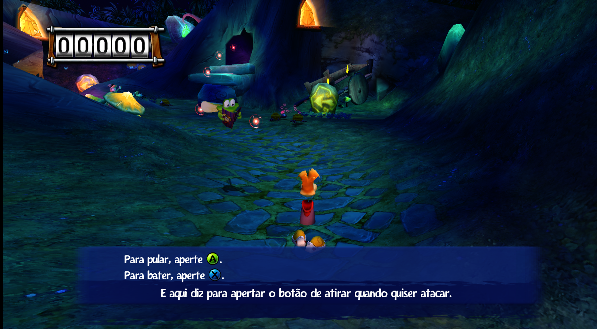

# Rayman 3 HD — Tradução PT-BR

Tradução para português do Brasil de **Rayman 3 HD** (versão Xbox 360), feita como *mod* para o port nativo para Windows
[Rayman 3 HD Recompiled](https://github.com/MysteriousAeon/rayman3-hd-recompiled), de MysteriousAeon.

> **Versão 1.0.0.** Menus, dicas, bestiário, diálogos e legendas das cutscenes traduzidos. Veja [o que falta](#o-que-falta).

## Capturas de tela







## O que está traduzido

| Parte | Quantidade |
|---|---|
| Textos do jogo (menus, dicas de botões, bestiário, diálogos, avisos de salvamento, comentaristas da arena) | 1.026 |
| Legendas das cutscenes | 68 |
| **Total** | **1.094 de 1.120 strings** |

As 26 restantes ficaram como no original de propósito (alfabeto da tela de nome, "OK", "Arcade", "Extra", "Gamertag",
nomes de ranking, gritos e onomatopeias).

## O que falta

- **Nomes e descrições das conquistas** (12 conquistas): ainda em inglês.
- **Créditos finais**: continuam em inglês (o mod turco do projeto também os mantém).
- **Vozes**: continuam em inglês (o mod só troca texto). Use as legendas.
- **Imagens com texto** (logotipos, alguns botões): não alteradas.

## Como instalar

Você precisa ter o **Rayman 3 HD Recompiled** funcionando, com a sua própria cópia do jogo do Xbox 360.

1. Baixe o [`rayman3-ptbr-1.0.0.zip`](https://github.com/crispinhatt/Rayman3HD-Traducao-PTBR/raw/main/rayman3-ptbr-1.0.0.zip) (arquivo na raiz deste repositório). Não precisa descompactar.
2. No jogo, abra **Settings > Mods > Install .zip** e escolha o arquivo.
3. Deixe o mod ativado (caixa marcada) e **reinicie o jogo**.
4. Se tiver outro mod de idioma instalado (por exemplo o turco), desative-o.

Para voltar ao inglês, desative ou remova o mod em **Settings > Mods** e reinicie. Os arquivos do jogo nunca são alterados.

## Este repositório

```
rayman3-ptbr-1.0.0.zip        o mod pronto para instalar
imagens/                      capturas de tela usadas neste README
mod/mod.json                  mod em texto (só português + hashes de conferência)
traducao/traducao_ptbr.csv    a tradução em planilha (tipo ; chave ; bytes_orig ; ptbr ; hash_orig)
ferramentas/gerar_mod.py      planilha -> mod.json (valida acentos, códigos de controle e caracteres proibidos)
ferramentas/preencher_ingles.py  cria uma planilha LOCAL com o inglês do SEU jogo, para revisar/continuar
COMO_FUNCIONA.md              detalhes técnicos
```

### Gerar o mod a partir da planilha

```
cd ferramentas
python gerar_mod.py ..\traducao\traducao_ptbr.csv ..\mod --version 1.0.0
```

Depois empacote e valide com a ferramenta do próprio projeto (na pasta de instalação do jogo):

```
app\python\python.exe app\tools\r3hd_modkit.py --home . pack <pasta-do-mod> rayman3-ptbr-1.0.0.zip
```

### Corrigir ou continuar a tradução

1. Rode `preencher_ingles.py` apontando para a pasta `data\content\GAMEDATAbin` do seu jogo. Ele cria uma planilha local com o inglês ao lado.
2. Edite a coluna `ptbr`. Mantenha os códigos de controle (`\l`, `\jc`, `\f1:c`, `\f0:`...) exatamente como no original.
3. Rode `gerar_mod.py` de novo.

## Avisos legais

Este é um projeto de fãs, sem fins lucrativos e sem afiliação com a Ubisoft. *Rayman* e *Rayman 3* são marcas da Ubisoft.
O repositório **não contém arquivos do jogo nem o texto original em inglês**: o mod só carrega as frases em português e
hashes que identificam qual string do jogo cada uma substitui. É preciso ter a sua própria cópia do jogo.

## Créditos

- Tradução e ferramentas: **PINHATT** (crispinhatt).
- [Rayman 3 HD Recompiled](https://github.com/MysteriousAeon/rayman3-hd-recompiled) e o sistema de mods: **MysteriousAeon**. O mod turco distribuído com o projeto serviu de referência para o formato; nenhum texto dele foi reaproveitado.
- Jogo original: Ubisoft.
